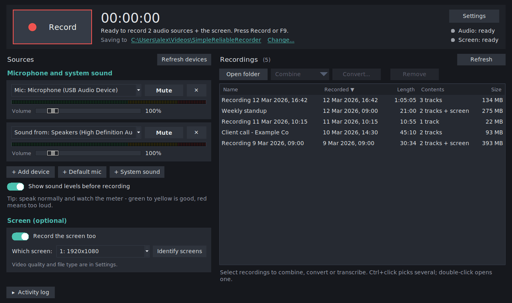

# SimpleReliableRecorder

A dead-simple, safety-first recorder. Pick your microphone and your system
playback, hit **RECORD**, and it writes them to disk continuously so a crash or
power loss costs at most a couple of seconds, never the whole take.

If recording ever stops it is impossible to miss: a flashing gold bar drops
across the bottom of the window, the taskbar flashes, an alert sound plays, and
an independent watchdog process raises an OS alert even if the app itself
hangs. Every alert channel (sound, gold banner, taskbar flash, watchdog alert)
and the background watchdog can be turned on or off in Settings.



## Features

- **Audio**: any number of microphones plus system-playback devices (WASAPI
  loopback on Windows, no virtual cable needed). Add more with the **+** buttons.
- **Save modes**:
  - Separate file per device (default, safest)
  - Separate channels in one file (mic = ch1, playback = ch2, ...)
  - Single mixed file
- **Per-device gain + live level meters** so you can balance every source
  before and during recording.
- **Screen recording** (optional, fully independent): pick a monitor from a
  dropdown (**Identify screens** shows a big number on each display). Encoders:
  NVIDIA NVENC, Intel Quick Sync, AMD AMF, Apple VideoToolbox, or CPU, with
  automatic fallback. Records silent video; combine with audio afterward.
- **Combine (after the fact, non-destructive)**: mux video and audio into one
  file, merge per-device WAVs into one multichannel WAV, mix to stereo, or
  convert every ticked recording to another format in one go. Several jobs
  queue up and run back to back. Your original separate tracks are always kept.
- **Transcription (optional, via [Scrivox](https://github.com/kawaconnect/Scrivox))**:
  when a Scrivox install is detected, the library grows a **Transcribe with
  Scrivox** button - tick recordings and get a transcript saved next to each
  one, either audio-only or with on-screen descriptions for takes that include
  video. See below.
- **Resilience**: in-process monitors plus a separate watchdog process and
  heartbeat files, with optional auto-restart on failure.
- **Immense logging**: rotating logs in the data folder plus a live in-app log.

## Platform notes

- **Windows**: system playback is captured via WASAPI loopback; everything
  works out of the box.
- **macOS**: microphone capture works natively, but capturing system playback
  (loopback) requires a virtual audio device such as BlackHole.
- **Linux**: screen capture uses X11. On Wayland sessions it requires
  XWayland; native Wayland capture (portals) is not supported.

## Requirements

- **Windows** 10 or 11, x64 (an arm64 build is also published).
- **macOS** on Apple Silicon or Intel. The first screen recording asks for the
  Screen Recording permission and the first audio capture for the Microphone
  permission (System Settings > Privacy & Security).
- **Linux** with glibc 2.35 or newer (Ubuntu 22.04+, Debian 12+), an X11 or
  XWayland session for screen capture, and PulseAudio or PipeWire with
  `pipewire-pulse` for audio.

The release builds need nothing else installed: Python and ffmpeg are inside
the executable.

## Install

Prebuilt binaries are attached to each
[release](https://github.com/kawaconnect/SimpleReliableRecorder/releases).

- **Windows**: run `SimpleReliableRecorder-<version>-windows-x64-setup.exe`
  (installs to Program Files, adds a Start menu entry and an uninstaller), or
  unzip the portable `SimpleReliableRecorder.exe` anywhere and double-click it.
  The builds are not code signed, so SmartScreen may ask you to confirm with
  **More info > Run anyway**.
- **macOS**: extract the `macos-arm64` (Apple Silicon) or `macos-x64` (Intel)
  archive and start `SimpleReliableRecorder`. It is ad-hoc signed, not
  notarized: right-click it and choose **Open** the first time.
- **Linux**: extract the `linux-x64` (or `linux-arm64`) archive and run
  `./SimpleReliableRecorder`.

There is no auto-update: to upgrade, install or extract the newer release over
the old one. Settings and the recordings list are kept.

## Run from source

Python 3.11 or newer with Tk 8.6.

```sh
pip install -r requirements.txt
python main.py
```

On Debian/Ubuntu also install the system libraries first:
`sudo apt install python3-tk libsndfile1 libpulse0 ffmpeg`. A source run uses
`./ffmpeg/ffmpeg` (`ffmpeg.exe` on Windows) if present, otherwise the `ffmpeg`
on your PATH; without one, audio recording still works but screen recording
and Combine do not.

Run the tests with `python -m unittest discover -s tests -t .` (set
`SRR_SKIP_GUI_TESTS=1` on a machine without a display).

## Build the single executable

```powershell
python build.py --clean
# -> dist\SimpleReliableRecorder.exe  (ffmpeg bundled inside)
```

`build.py` stages an ffmpeg binary from `./ffmpeg/`, `FFMPEG_EXE`, or your
PATH (in that order). Use a full build (gyan.dev "full"/"git" or BtbN) so
NVENC/QSV/AMF are present. If none is found the build still succeeds, with a
warning, and the resulting app cannot record the screen. Set `SRR_NO_SPLASH=1`
to build the Windows executable without the startup splash image.

## Building / Releases (GitLab CI)

`.gitlab-ci.yml` builds the app on the self-hosted GitLab runners. It is a
port of `.github/workflows/build.yml`, which still builds the release files
published on GitHub (including the two arm64 builds).

- **When it runs**: on a release tag (this project uses bare `X.Y.Z` tags such
  as `0.0.17`; `vX.Y.Z` also works), when started by hand from the GitLab
  UI (Build > Pipelines > Run pipeline) or the API, and on merge requests.
  A merge request runs the tests and the Linux build; the Windows and macOS
  builds are manual there and nothing is published. Plain pushes do not start
  it.
- **test**: the unit tests in the `python` image pinned in `.gitlab-ci.yml`.
  A tag build also checks that `recorder/__init__.py`'s `__version__` equals
  the tag, so bump it before tagging.
- **build-linux** (`linux-x64`): Ubuntu 22.04 container, so the binary runs on
  glibc 2.35+ (Ubuntu 22.04+, Debian 12+).
- **build-windows** (`windows-x64`): the Windows runner; portable zip plus the
  Inno Setup installer. Python 3.12 with Tk and Inno Setup are installed on
  first use by `ci/tools-windows.ps1` (pinned, SHA-256 checked).
- **build-macos** (`macos-arm64`, `macos-x64`): the Apple Silicon runner; the
  x64 build uses an x86_64 Python under Rosetta 2. Python comes from a pinned
  `uv` (`ci/tools-macos.sh`). Binaries are ad-hoc signed, not notarized.
- Every build downloads a **static** ffmpeg (`ci/stage-ffmpeg-*`) with the same
  sources and checks as the GitHub workflow: right architecture, no
  non-system libraries, and it must run. If no source passes, the build fails
  rather than bundling a system ffmpeg. The unit tests then run again on the
  build's own Python, `python build.py --clean` packages the app, and
  `ci/check_bundle.py` confirms that ffmpeg, the icon and the audio, tray and
  hotkey packages are inside the executable.
- **release** (tag pipelines only): uploads every file to the project's
  Generic Package Registry (`SimpleReliableRecorder/<version>/`) and creates
  or updates the GitLab Release for the tag. The release notes are the tag's
  `CHANGELOG.md` section. To republish an existing tag, run the pipeline on
  that tag with `RELEASE_VERSION=<version>`.
- **Not built on GitLab**: `windows-arm64` and `linux-arm64`, because there
  are no arm64 runners. Only the GitHub workflow produces those.

Release files: `SimpleReliableRecorder-<version>-windows-x64-setup.exe`,
`SimpleReliableRecorder-windows-x64-portable.zip`, and
`SimpleReliableRecorder-<label>-portable.tar.gz` for `linux-x64`,
`macos-arm64` and `macos-x64`.

## Where files go

- Recordings: one `SRR_<date>_<time>` folder per take under
  `Videos\SimpleReliableRecorder\` (`~/Movies/SimpleReliableRecorder/` on
  macOS, `~/Videos/SimpleReliableRecorder/` on Linux). Change the folder, or
  turn on "ask every time", in **Settings > Saving**.
- Config (`config.json`) and logs (`logs/`): in a `data` folder next to the
  executable when that location is writable (portable use). Otherwise, for
  example when installed to Program Files:
  - Windows: `%APPDATA%\SimpleReliableRecorder\`
  - macOS: `~/Library/Application Support/SimpleReliableRecorder/`
  - Linux: `$XDG_CONFIG_HOME/SimpleReliableRecorder/` (default
    `~/.config/SimpleReliableRecorder/`)

  A source run keeps both in `_data/` inside the checkout.
- Logs rotate at 8 MB with 8 old files kept per log. They contain device
  names and file paths, nothing else from your recordings.

## Quick start

1. The default mic and system playback are added automatically on first run.
2. Optional: enable **Record a screen**, click **Identify screens**, pick the monitor.
3. Hit **RECORD**. Watch the green status lights. Hit **STOP** when done.
4. Optional: use the **Combine** buttons to stitch tracks together.

Keyboard: **F9** starts and stops recording, **Ctrl+,** opens Settings,
**Ctrl+O** opens the recordings folder, **Ctrl+L** shows the activity log.

## Settings

Everything is in the **Settings** window (Ctrl+,) and saved to `config.json`
as you change it:

- **Recording**: audio file format (16-bit or 32-bit float), save mode, and
  the screen video's file type (MKV or MP4), codec, encoder, quality, frame
  rate and crash-safety level.
- **Saving**: the recordings folder, "ask every time", and what to do with
  screen and audio when a recording stops.
- **Safety & alerts**: auto-restart, the background watchdog, and each alert
  channel (sound, gold banner, taskbar flash, watchdog message box).
- **Hotkey & tray**: the tray icon and a global push-to-talk, push-to-mute or
  toggle key for one microphone or all of them.
- **Transcription**: where Scrivox was found, and a manual path.

`config.json` is plain JSON and safe to delete (defaults come back). A file
that cannot be parsed is copied to `config.json.corrupt-<timestamp>` and
defaults are used. Two environment variables exist for unusual setups:
`SRR_DISABLE_HOTKEYS=1` turns global hotkeys off without loading the keyboard
hook library, and `SRR_SKIP_GUI_TESTS=1` skips the window tests.

## Transcription with Scrivox

[Scrivox](https://github.com/kawaconnect/Scrivox) is a standalone GPU
transcription suite (Whisper + speaker diarization + on-screen descriptions +
summaries). When both apps are present, SimpleReliableRecorder finds it
automatically - no setup:

- Portable: put the Scrivox folder (or `Scrivox.exe`) next to
  `SimpleReliableRecorder.exe`, or keep both app folders side by side.
- Installed: any installed Scrivox is found via the usual install locations,
  the registry, and PATH.

Tick recordings in the library and click **Transcribe with Scrivox...** (also
available on right-click). Choose audio-only or, for takes with video,
"describe what's on screen" as well; each transcript is saved next to its
recording as .txt / .md / .srt / .vtt / .json. Multi-track takes are mixed
automatically for transcription - your originals are never touched.

The transcription itself (model, language, speaker names, API keys,
translation, description detail) follows whatever you configured in Scrivox:
the **Open Scrivox** button in Settings (or in the transcribe dialog) opens it
to change them.

If Scrivox is not present, none of this UI exists - the app stays exactly as
lean as before. Unusual setups can point the optional `scrivox_path` key in
`config.json` at a specific `Scrivox.exe`.

Scrivox is run as a separate program with your user rights. Automatic
detection also looks for a `Scrivox*` folder in your Downloads, Desktop and
home folders, so only keep a `Scrivox.exe` there that you trust, or set
`scrivox_path` to pin the one you mean.

## Troubleshooting

- **Where are the logs?** In the `logs` folder described under "Where files
  go"; `app.gui.log` has everything, `app.watchdog.log` the watchdog. The
  activity log at the bottom of the window (Ctrl+L) shows the same messages
  live.
- **"The video tool that ships with the app (ffmpeg) is missing"**: the
  executable was built without ffmpeg, or a source run has none on PATH.
  Reinstall a release build, or install ffmpeg. Audio recording is unaffected.
- **No system playback device (macOS)**: macOS has no built-in loopback.
  Install a virtual device such as BlackHole and select it as a source.
- **Screen video is black**: on macOS grant the Screen Recording permission
  and restart the app; on Linux log in with an X11 session (native Wayland
  windows are not captured).
- **The hotkey does nothing**: another program may own the key (Windows). On
  Linux the hotkey library only works when the app runs as root, and on macOS
  the app needs the Accessibility permission. Settings shows whether the key
  was registered.
- **A device is "in use"**: another program opened it in exclusive mode.
  Close that program, or turn off "Allow applications to take exclusive
  control" for the device in the Windows Sound settings.
- **The app closed or hung during a recording**: the audio already written is
  intact (WAV headers are kept valid while recording) and MKV or the default
  MP4 mode stays playable up to the last second. Start the app again and the
  take shows up in the recordings list.
- **The watchdog alert keeps appearing**: a device stopped delivering data
  for longer than the stale limit. Check the cable or device, or turn
  individual alert channels off under **Settings > Safety & alerts**.
